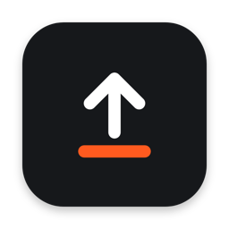
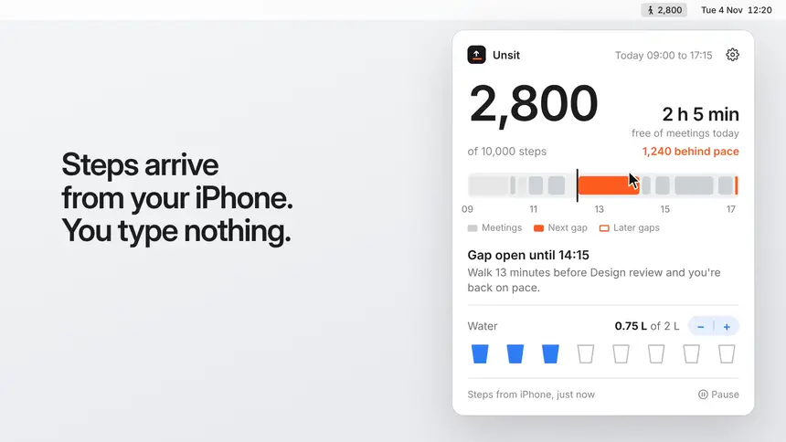
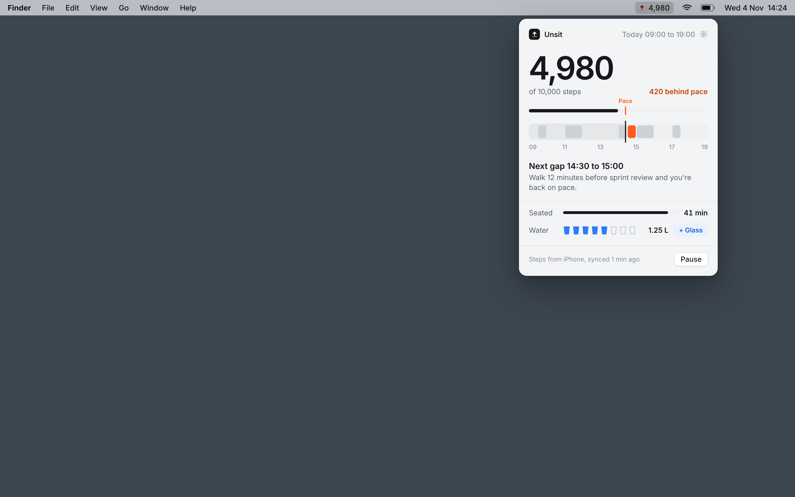
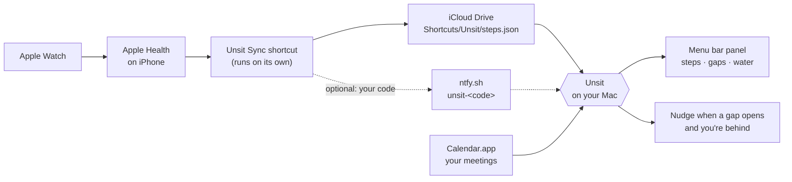

<div align="center">



# Unsit

**Your chair can wait.**

A macOS menu bar app that gets you to 10,000 steps and enough water during the workday. It reads your calendar, finds the gaps between meetings, and tells you when to walk. Your steps arrive from your iPhone and Apple Watch on their own.

[](Resources/Info.plist)
[](LICENSE.md)
[](https://github.com/jorgesousa/Unsit/actions/workflows/build.yml)


<a href="https://github.com/jorgesousa/Unsit/raw/main/docs/unsit.mp4">
  
</a>

<sub>▶ <a href="https://github.com/jorgesousa/Unsit/raw/main/docs/unsit.mp4">Watch with sound</a> · 20 seconds</sub>

</div>

---

## Install

You need **macOS 14 or later**, the **Xcode command line tools**, and an **iPhone with Apple Health** signed in to the same iCloud account as your Mac. Android phones are coming soon.

```bash
xcode-select --install          # only if you don't have the command line tools yet
git clone https://github.com/jorgesousa/Unsit
cd Unsit
scripts/build-app.sh --open
```

That builds `Unsit.app`, copies it to `/Applications` and opens it. A setup window then walks you through connecting your iPhone and your calendar, in about three minutes. No App Store, and no Apple Developer account.

See [Get started](#get-started) for every step, and [Updating](#updating) for later.

## Why

Ten thousand steps sounds easy until your calendar is back to back. The time to walk is usually there: fifteen minutes between two calls, half an hour before lunch. You just don't notice it until it's gone.

Unsit looks at your day the way you would if you had time to plan it: where the meetings are, where the gaps are, and how far behind you are. When a gap opens and you're behind, it tells you, with how long to walk.

## What you get

<table>
<tr>
<td width="50%" valign="top">

### 🚶 Steps from your iPhone, no typing
A free Apple shortcut copies today's steps from Apple Health to iCloud Drive, and Unsit reads them. Apple Watch steps count too, because they're in Health.

</td>
<td width="50%" valign="top">

### 📅 Your day on one strip
Meetings in grey, the next gap in solid orange, later gaps outlined. Hover over any block to see the meeting, or how long the gap is and how many steps fit in it.

</td>
</tr>
<tr>
<td valign="top">

### ⏱️ Time, not just steps
Next to your step count: how much of today is still **free of meetings**. Under your day: how much **walking is left** and when to do it, like *Walk 12 minutes before Design review and you're back on pace.* If it won't fit in your gaps, it says so in orange.

</td>
<td valign="top">

### 🔔 A nudge at the right moment
When a gap between meetings opens and you're more than 300 steps behind pace, a strip drops from the top of the screen. **Going** quiets it until the gap ends; **In 10 min** asks again later.

</td>
</tr>
<tr>
<td colspan="2" valign="top">

### 💼 Works on your work Mac too
No iCloud on that Mac? Connect it with a **code**. Your iPhone sends today's steps to the code through [ntfy.sh](https://ntfy.sh), and every Mac with the same code reads them, at the same time as your own Mac.

</td>
</tr>
<tr>
<td valign="top">

### 💧 Water in glasses
Tap a cup to fill up to it, tap the last full one to take it back, or use **−** and **+**. Goal and glass size are yours to set.

</td>
<td valign="top">

### 🤫 Polite by design
No nudges during a meeting, while you're away from the Mac (idle for 5 minutes or asleep), outside your workday, or once you've reached your goal. **Pause** stops them for an hour, two hours, or the rest of the day.

</td>
</tr>
</table>

<p align="center"></p>

The menu bar shows today's steps next to a walking figure. The panel's footer says when steps last arrived from your iPhone, and turns orange when that was more than 90 minutes ago, so you notice if an automation stops.

**Settings** has three tabs: **General** (workday hours, step and water goals, glass size, open at login), **iPhone** (when steps last arrived, choose the steps file by hand, set up the iPhone again) and **Author** (version and **Check for updates**). Unsit checks GitHub once a day for a newer version. When there is one, the gear menu shows **Update to …** and the Author tab shows how to update.

## How it works



Apple Health isn't available on the Mac, so the iPhone does the reading. The **Unsit Sync** shortcut writes one small file:

```json
{"steps": "4980", "updatedAt": "2026-11-04T14:24:00+00:00"}
```

Unsit checks that file every 15 seconds and only uses it when it's from today.

**Macs without your iCloud.** The shortcut can also post the same text to `https://ntfy.sh/unsit-<code>`, where the code is a random 20-character string that Unsit makes for you. Each Mac with that code asks ntfy.sh for the latest message once a minute. When both arrive, the newer one from today wins.

**Pace.** At any moment of your workday you should have walked that share of your goal: halfway through a 09:00 to 19:00 day, that's 5,000 of 10,000. The difference is how far behind you are.

**Walking time.** Unsit counts 100 steps a minute, a moderate walking pace in studies of adult cadence (about 130 is brisk). So 4,000 steps left is about 40 minutes.

**Meetings.** Every calendar in Calendar.app counts, except all-day events and events marked Free. Your calendar is read on this Mac and nothing leaves it.

## Get started

### 1. Build and open the app

```bash
git clone https://github.com/jorgesousa/Unsit
cd Unsit
scripts/build-app.sh --open
```

| Command | What it does |
|---|---|
| `scripts/build-app.sh` | Builds `build/Unsit.app` only |
| `scripts/build-app.sh --install` | Builds and copies it to `/Applications` |
| `scripts/build-app.sh --open` | Builds, copies it to `/Applications` and opens it |

### 2. Connect your iPhone

The setup window opens on first launch and shows a QR code.

1. **Add the shortcut.** Scan the QR code with your iPhone camera and tap **Add Shortcut**.
2. **Run it once.** Open Shortcuts, tap **Unsit Sync** and allow **Steps** when Health asks. The setup window shows **Connected** with today's steps. Check they match the Health app.
3. **Keep it fresh.** In Shortcuts › **Automation**, add two automations that run Unsit Sync. For both, choose **Run Immediately** and turn off **Notify When Run**.
   - **Time of Day**, daily, at 09:00, 10:30, 12:00, 13:30, 15:00, 16:30 and 18:00.
   - **App › Is Opened**, for apps you open all day, like Slack, Teams or Mail.

<details>
<summary><b>Build the shortcut by hand instead</b></summary>

<br>

In Shortcuts on your iPhone, tap **+**, name it **Unsit Sync** and add these actions in order:

1. **Find Health Samples**: Type is **Steps**, Start Date **is today**, Group By **Day**, **Fill Missing off**.
2. **Get Details of Health Samples**: **Value**.
3. **Round Number**: to **Integer**.
4. **Text**: `{"steps": "[Rounded Number]", "updatedAt": "[Current Date]"}`. Tap **Current Date**, set its format to **ISO 8601** and turn on **Include ISO 8601 Time**.
5. **Save File**: to `Shortcuts/Unsit/steps.json`. Turn off **Ask Where to Save** and turn on **Overwrite If File Exists**.

Run it once and allow Steps. The setup window has the same steps under **Build it by hand instead**.

</details>

### 3. Optional: a Mac without your iCloud

For a work Mac, or any Mac signed in to another Apple Account:

1. On your own Mac, open Settings › **iPhone** › **Connect with a code…** and copy the code.
2. On your iPhone, add one action at the end of **Unsit Sync**: **Get Contents of URL**, with the URL shown in that window (`https://ntfy.sh/unsit-<your code>`), Method **POST**, Request Body **File**, and pick the **Text** variable.
3. On the other Mac, install Unsit. In the setup window choose **This Mac isn't signed in to your iCloud? Connect with a code**, paste the code and click **Use this code**.

The code is the only thing protecting the channel: anyone who knows it can read your step count. Keep it to yourself. ntfy.sh keeps each message for 12 hours.

### 4. Allow your calendar

The last setup step shows your day on the strip and asks for calendar access. Set your workday hours there too; you can change them later in Settings. Turn on **Open Unsit when you log in** to keep it running.

### Troubleshooting

- **The count doesn't change, or setup says there's no steps file yet.** On your iPhone, open **Files** › iCloud Drive › Shortcuts › Unsit and check that `steps.json` (or `steps.txt`) is there. On the Mac, Settings › **iPhone** › **Choose steps file…** points Unsit at the file by hand.
- **A Mac with a code shows no steps.** Settings › **iPhone** shows when steps last came through the code. Check the code is the same on both Macs and in the shortcut's URL. In Terminal, `curl -s "https://ntfy.sh/unsit-<your code>/json?poll=1&since=latest"` shows the last message the iPhone sent. Some company networks block ntfy.sh.
- **Steps look doubled, or show two numbers.** In the shortcut, Group By must be **Day** and **Fill Missing** must be off.
- **macOS asks for calendar access again after a rebuild.** Builds are ad-hoc signed, so macOS treats each one as a new app. See [Keep calendar access between builds](#keep-calendar-access-between-builds).
- **No icon in the menu bar.** When the menu bar is full, macOS hides icons that don't fit. Quit an app with an icon there, or ⌘-drag icons to make room.

## Updating

Unsit checks GitHub once a day. When a newer version is out, the gear menu shows **Update to …**, and Settings › **Author** shows these steps:

```bash
cd Unsit          # the folder you cloned
git pull
scripts/build-app.sh --open
```

The script quits the running copy, installs the new one and opens it. Your goals, workday and today's water are kept.

### Keep calendar access between builds

Ad-hoc signed builds look like a new app to macOS each time, so it asks for calendar access again. To avoid that, create a self-signed certificate once:

1. Open **Keychain Access › Certificate Assistant › Create a Certificate…**
2. Name it `Unsit Local`, Identity Type **Self Signed Root**, Certificate Type **Code Signing**.
3. Build with it from then on:

```bash
SIGN_IDENTITY="Unsit Local" scripts/build-app.sh --open
```

### Share a ready-made app

Anyone can build from source with the steps above. To hand out an app that opens without a Gatekeeper warning, you need the Apple Developer Program (99 USD a year) to sign with Developer ID and notarize:

```bash
xcrun notarytool store-credentials unsit-notary --apple-id "you@example.com" --team-id "TEAMID" --password "app-specific-password"
SIGN_IDENTITY="Developer ID Application: Your Name (TEAMID)" scripts/build-app.sh
scripts/notarize.sh
```

That produces `build/Unsit.zip`, notarized and stapled.

## Development

```bash
swift test
scripts/build-app.sh
```

The tests cover the update check: comparing versions, reading GitHub's latest release, and reading the version from an Info.plist. GitHub Actions runs both commands on every push and pull request. `swift test` needs Xcode; the command line tools alone are enough to build.

| Path | What's in it |
|---|---|
| [`Sources/UnsitCore`](Sources/UnsitCore) | Platform-independent logic: `UpdateCheck` (is a version newer, read a release, read an Info.plist) |
| [`Sources/Unsit`](Sources/Unsit) | The macOS app: menu bar panel, day strip, nudge, water, settings, guided setup, update checker |
| [`Tests/UnsitCoreTests`](Tests/UnsitCoreTests) | Unit tests for the core |
| [`Resources/Info.plist`](Resources/Info.plist) | Version, bundle id, calendar permission text |
| [`scripts/build-app.sh`](scripts/build-app.sh) | Builds, signs, installs and opens `Unsit.app` |
| [`scripts/notarize.sh`](scripts/notarize.sh) | Notarizes for sharing (paid account) |
| [`.github/workflows/build.yml`](.github/workflows/build.yml) | Tests and builds on macOS 14 |

### Versions

The version lives in [`Resources/Info.plist`](Resources/Info.plist). It's what Settings › Author shows and what the update check compares.

- Every change that lands on `main` bumps `CFBundleShortVersionString` (0.2.0 → 0.2.1) and `CFBundleVersion`, the build number (2 → 3), and updates the version badge at the top of this file.
- A new feature bumps the middle number instead (0.2.1 → 0.3.0).
- Releases are tagged `v` plus the version, like `v0.2.0`. Until there are releases, the app compares with the version on `main`.

### Known limits

- **iPhone only for now.** Steps come from Apple Health through an iPhone shortcut. Android phones are coming soon.
- **Steps arrive when the shortcut runs**, not live. With the automations above, that's several times an hour.
- **No desktop widgets yet.** Widgets need App Groups, which need the paid developer account.
- **Not sandboxed**, so it can read the shortcut's file in iCloud Drive. Unsit reads only that file and your calendar. It goes online only to check GitHub for a newer version and, once a minute, to read your code on ntfy.sh.
- **The code route uses a third-party server.** Only the step count and the time go through ntfy.sh, on a channel named after your code. Water still stays on each Mac.

## Licence

Unsit is source-available under the [Sustainable Use License 1.0](LICENSE.md) (SPDX `SUL-1.0`). You can use and change it for free, for personal use or at work, **including commercially** for your own business. You can share it, with or without your changes, as long as you do so for free and for noncommercial purposes. Selling it, building a product or service from it, or including it in one needs a separate licence from the author.

## Author

Made by [Jorge Sousa](https://github.com/jorgesousa).

Copyright (c) 2026 Jorge Sousa (https://github.com/jorgesousa)

<div align="center">
<br>
<sub>Demo video made with <a href="https://github.com/latent-spaces/brag">/brag</a>.</sub>
</div>
